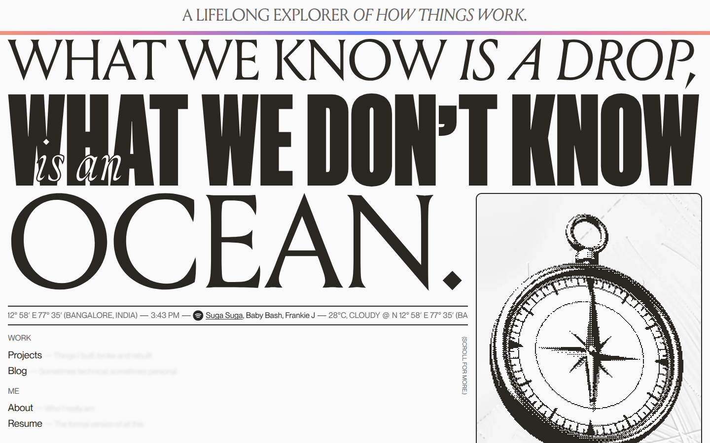

<h1>
  <picture><source media="(prefers-color-scheme: dark)" srcset="docs/readme/compass-dark.svg"></picture>
  romitraj.dev
</h1>

My corner on the internet, where I share my thoughts and show my work.

**[romitraj.dev](https://romitraj.dev)**




## <picture><source media="(prefers-color-scheme: dark)" srcset="docs/readme/gear-dark.svg"></picture> What this is

This is the code behind my personal website and portfolio. It has a home page, the projects I've built, a page about me, my resume, and my OpenPGP key if you want to send me an encrypted email. The longer writing lives on [my blog](https://blog.romitraj.dev), and the newest posts show up here by themselves.

The headline says _"What we know is a drop, what we don't know is an ocean."_ That's the idea behind the whole place: there's always more to learn, especially about the things I think I already know.

## <picture><source media="(prefers-color-scheme: dark)" srcset="docs/readme/sparkle-dark.svg"></picture> What makes it special

<picture><source media="(prefers-color-scheme: dark)" srcset="docs/readme/pages-dark.svg"></picture> **Pages that never reload.** Click a link and the old page leaves letter by letter while the new one slides in. The banner on top doesn't even blink. Getting one letter to stop jumping took me longer than I'd like to admit.

<picture><source media="(prefers-color-scheme: dark)" srcset="docs/readme/weather-dark.svg"></picture> **Live weather and music.** A thin moving strip on the home page shows the weather in Bangalore, my local time, and the song I'm playing on Spotify right now. If one of those services is having a bad day, that bit just hides. No error messages, no drama.

<picture><source media="(prefers-color-scheme: dark)" srcset="docs/readme/pictures-dark.svg"></picture> **Pictures made of chunky pixels.** A knight's emblem, and photos of old things made of metal and glass: a surveyor's theodolite, an old Kodak, a magnifying glass, an early Apple computer and a row of skeleton keys. Not one living thing in any of them. They are turned into two colours, ink and paper, each time the site is built. The compass on the home page is 3D, polished case, glass and all. It slowly tumbles on its own; grab it and spin it any way you like, and its needle wobbles back to north. Even the page you get for a wrong address is in on it: it tells you the page is lost in oblivion.

And it looks the same in Chrome, Edge, Firefox and Safari, on a laptop or a phone. One command opens every page in three browsers and complains loudly if anything is off.

## <picture><source media="(prefers-color-scheme: dark)" srcset="docs/readme/stack-dark.svg"></picture> What it's built with

Nothing fancy, on purpose.

- **[Eleventy](https://www.11ty.dev)** turns plain text files into the pages. Changing any text on the site means editing one file.
- **[GSAP](https://gsap.com)** and **[Taxi.js](https://github.com/craftedbygc/taxi)** do the movement and the page changes.
- A little hand-written **WebGL** draws the compass. Without it you get a still picture of the same compass.
- **[Vite+](https://viteplus.dev)** packs the styles and scripts into two small files, keeps the code tidy and runs the tests.
- **[sharp](https://sharp.pixelplumbing.com)** and **[jSquash](https://github.com/jamsinclair/jSquash)** make the pixel pictures and the photo, each in whichever format comes out smallest.
- A tiny **[Node.js](https://nodejs.org)** server hands out the pages and fetches the weather and the song.
- **[Playwright](https://playwright.dev)** is the one that opens three browsers and complains.

## <picture><source media="(prefers-color-scheme: dark)" srcset="docs/readme/terminal-dark.svg"></picture> Run it on your computer

You need [Node.js](https://nodejs.org) 26 and [pnpm](https://pnpm.io) ([Vite+](https://viteplus.dev) brings both). Then it's three commands:

```
pnpm install      # once, to fetch what it needs
pnpm run dev      # the site, live at http://localhost:8080
pnpm run check    # build it and test it in three browsers
```

Two things to know. The site's real fonts are licensed, so they are not in this repository; without them it uses free look-alikes and still works. And the weather shows up on its own, but the song needs Spotify keys of your own.

Every word on the site lives in `src/_data/` and `src/content/`, and every file starts with a short note on what it does.

## <picture><source media="(prefers-color-scheme: dark)" srcset="docs/readme/wrench-dark.svg"></picture> Maintenance

Notes for future me, back after a break with this repository and the font server's open side by side. First, read `INSTRUCTIONS.md` in the font server's repository: every rule, every chore and the steps for the server are in there.

**Each time I come back**

1. `pnpm install`, then `pnpm run lint` and `pnpm test` to make sure nothing broke while I was away.
2. Update. Look up the newest stable version of each tool on its official site, run `pnpm outdated`, and update one package at a time. Before a big version jump, read its upgrade guide. Each October, Node.js names a new LTS line (the long-term support version meant for real sites): move both repositories to it in `engines` in `package.json`.
3. Check. `pnpm run check` builds the site and tests every page in Chromium, Firefox and WebKit, and `pnpm run links` finds dead links. Then I open the site with `pnpm run dev` and look at it myself.
4. Commit, then push `main`. Pushing is the deploy: the server rebuilds the site by itself. I watch it finish in the hosting dashboard and open the live site.

**On a calendar**

- **Every 6 months:** Spotify's token runs out. `pnpm run spotify` gets a new one, then I paste it into the server's settings and deploy again. Next one due around April 2027.
- **Every year:** renew the domain, check when the Cloudflare certificate expires, and make sure the weather and the song still show up.
- **Before September 2029:** extend my OpenPGP key and swap in the new file.
- **When GitHub emails a security alert:** update that package first.

**When something changes**

- New project: copy `src/content/projects/_template.md` and fill it in.
- New font files: `pnpm run fonts` turns them into web fonts.
- New headline, fonts, colours or compass: `pnpm run fit` so the big lines fill their space, then `pnpm run share` to redraw the link preview picture and the screenshot above.
- If the server ever moves to a new address, update the Cloudflare rule that lets it read the blog's feed, or new posts quietly stop showing up.

## <picture><source media="(prefers-color-scheme: dark)" srcset="docs/readme/heart-dark.svg"></picture> Credits

- The design is based on [henry.codes](https://henry.codes) by Henry Desroches. The code and words here are my own.
- The pictures are made from photos on [Unsplash](https://unsplash.com), some of them shared there by museums, and one drawing from [Pixabay](https://pixabay.com). Each one is credited on the site's [Credits page](https://romitraj.dev/credits/).
- Weather data by [Open-Meteo.com](https://open-meteo.com). Icons by [Phosphor Icons](https://phosphoricons.com).

## <picture><source media="(prefers-color-scheme: dark)" srcset="docs/readme/scales-dark.svg"></picture> License

The code is [MIT](LICENSE) licensed, so take what is useful. The site's content (the words, my bio, the project write-ups) is all rights reserved, the pictures stay under their own licences (Unsplash and Pixabay), and the fallback fonts under the SIL Open Font License.
