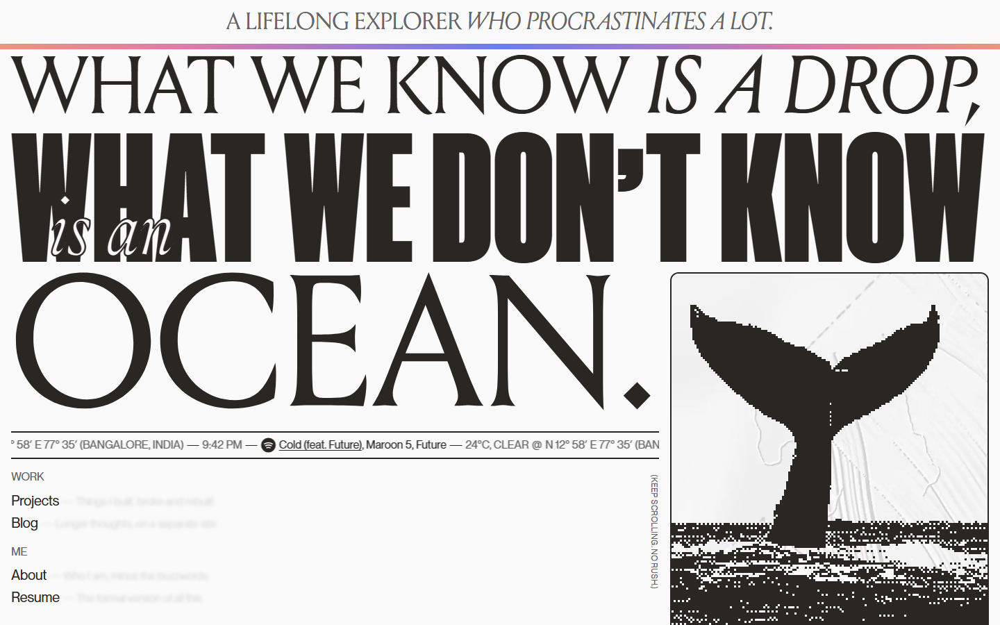

<h1>
  <picture><source media="(prefers-color-scheme: dark)" srcset="docs/readme/compass-dark.svg"></picture>
  romitraj.dev
</h1>

My corner of the internet. Part portfolio, part proof that I do finish things (eventually).

**[romitraj.dev](https://romitraj.dev)**




## <picture><source media="(prefers-color-scheme: dark)" srcset="docs/readme/anchor-dark.svg"></picture> What this is

This is the code behind my personal website. It has a home page, a list of things I built, a page about me, and a resume I keep promising to finish. The longer writing lives on [my blog](https://blog.romitraj.dev), and the newest posts show up here by themselves.

The headline says *"What we know is a drop, what we don't know is an ocean."* That is pretty much the mood of the whole place: a lot of sea, one diver, and a compass in the corner.

## <picture><source media="(prefers-color-scheme: dark)" srcset="docs/readme/sparkle-dark.svg"></picture> What makes it special

<picture><source media="(prefers-color-scheme: dark)" srcset="docs/readme/pages-dark.svg"></picture> **Pages that never reload.** Click a link and the old page leaves letter by letter while the new one slides in. The banner on top doesn't even blink. Getting one letter to stop jumping took me longer than I'd like to admit.

<picture><source media="(prefers-color-scheme: dark)" srcset="docs/readme/weather-dark.svg"></picture> **Live weather and music.** A thin moving strip on the home page shows the weather in Bangalore, my local time, and the song I'm playing on Spotify right now. If one of those services is having a bad day, that bit just hides. No error messages, no drama.

<picture><source media="(prefers-color-scheme: dark)" srcset="docs/readme/pictures-dark.svg"></picture> **Pictures made of chunky pixels.** Every photo and drawing is turned into two colours, ink and paper, each time the site is built. The diver, the compass and the waves were drawn just for this site. Even the page you get for a wrong address is in on it: it tells you the page is lost at sea.

And it looks the same in Chrome, Edge, Firefox and Safari, on a laptop or a phone. One command opens every page in three browsers and complains loudly if anything is off.

## <picture><source media="(prefers-color-scheme: dark)" srcset="docs/readme/stack-dark.svg"></picture> What it's built with

Nothing fancy, on purpose.

- **[Eleventy](https://www.11ty.dev)** turns plain text files into the pages. Changing any text on the site means editing one file.
- **[GSAP](https://gsap.com)** and **[Taxi.js](https://github.com/craftedbygc/taxi)** do the movement and the page changes.
- **[esbuild](https://esbuild.github.io)** packs the styles and scripts into two small files.
- **[sharp](https://sharp.pixelplumbing.com)** makes the pixel pictures.
- A tiny **[Node.js](https://nodejs.org)** server hands out the pages and fetches the weather and the song.
- **[Playwright](https://playwright.dev)** is the one that opens three browsers and complains.

## <picture><source media="(prefers-color-scheme: dark)" srcset="docs/readme/terminal-dark.svg"></picture> Run it on your computer

You need [Node.js](https://nodejs.org) 24. Then it's three commands:

```
npm install      # once, to fetch what it needs
npm run dev      # the site, live at http://localhost:8080
npm run check    # build it and test it in three browsers
```

Two things to know. The site's real fonts are licensed, so they are not in this repository; without them it uses free look-alikes and still works. And the weather shows up on its own, but the song needs Spotify keys of your own.

Everything else, from changing a sentence to putting it on a server, is in the [guide](docs/guide.md).

## <picture><source media="(prefers-color-scheme: dark)" srcset="docs/readme/heart-dark.svg"></picture> Credits

- The design is based on [henry.codes](https://henry.codes) by Henry Desroches. The code, words and pictures here are my own.
- The photographs are placeholders from [Unsplash](https://unsplash.com) until I take my own. Each photographer is named on the site's [Credits page](https://romitraj.dev/credits/).
- Weather data by [Open-Meteo.com](https://open-meteo.com). Icons by [Phosphor Icons](https://phosphoricons.com).

## <picture><source media="(prefers-color-scheme: dark)" srcset="docs/readme/scales-dark.svg"></picture> License

The code is [MIT](LICENSE) licensed, so take what is useful. The site's content (the words, my bio, the project write-ups) is all rights reserved, the photos stay under the Unsplash License, and the fallback fonts under the SIL Open Font License.
